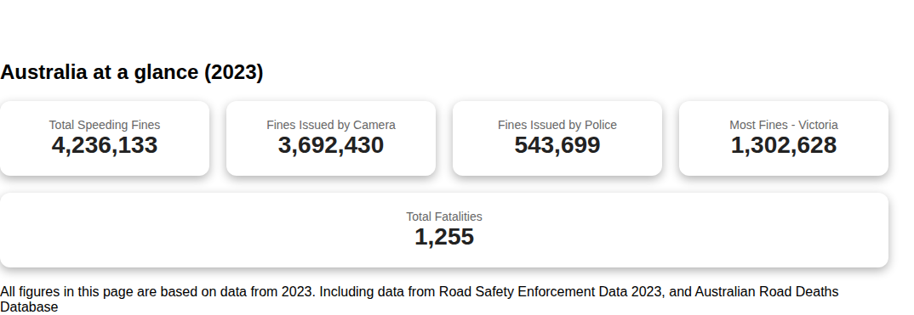
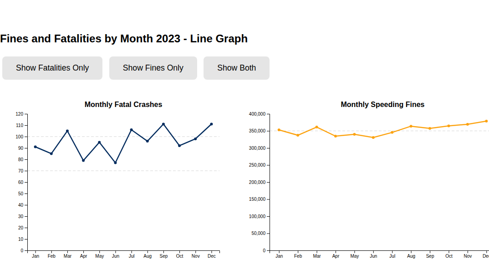
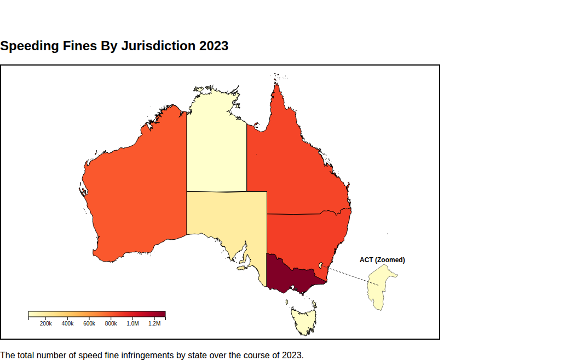

# Trends in Australian Speeding Enforcement

An interactive data-visualisation dashboard exploring **speeding enforcement and road fatalities across Australia**. Built with vanilla JavaScript, D3.js, HTML, and CSS as a collaborative university project.

The site brings together national and state-level road-safety data to make comparisons between fines, detection methods, jurisdictions, and fatalities easier to explore.

## Dashboard sections

- **2023 at a glance:** headline Australian enforcement and fatality figures.
- **Monthly trends:** switch between fines, fatalities, or both.
- **Chart and table views:** compare monthly figures.
- **Speeding fines by jurisdiction:** interactive geographic overview.
- **Fatalities by jurisdiction:** compare state and territory figures.
- **Fatalities by speed limit:** explore recorded fatality figures across speed-limit ranges.
- **2008–2023 trends:** historical charts for fines and road fatalities.

The page includes navigation shortcuts, hover interactions, and controls for switching between visualizations.

## Screenshots

Captured from the running dashboard using the repository's included 2023 CSV datasets.

**National figures**



**Monthly fines and fatal crashes**



**Speeding fines by jurisdiction**



## Technology

- HTML and CSS for the document and responsive presentation.
- JavaScript and **D3.js v7** for loading CSV data and rendering interactive charts.
- Local CSV files under `data/`, with data transformation and rendering modules under `js/`.

No build framework or application server is required, but **the page needs to be served over HTTP** so the browser can load its CSV files.

## Run locally

From the repository root:

```bash
python -m http.server 8000
```

Open <http://localhost:8000/> in your browser.

Alternatively, use any local static file server. The site loads D3 and some visual assets from external CDNs, so an internet connection may be needed.

## Data and attribution

The source data is derived from Australian public road-safety publications. The processed CSV files used by the dashboard are included in this repository.

- [Road Safety Enforcement Data 2023 — Bureau of Infrastructure and Transport Research Economics](https://www.bitre.gov.au/publications/2024/road-safety-enforcement-data)
- [Road Safety Enforcement Data dataset](https://catalogue.data.infrastructure.gov.au/dataset/road-safety-enforcement-data)
- [Australian Road Deaths Database](https://catalogue.data.infrastructure.gov.au/dataset/australian-road-deaths-database)

The page includes additional jurisdiction-specific notes and acknowledgements in its **Data Sources** section. Data availability and reporting methods vary between jurisdictions and years, so comparisons need context. For example, the project's monthly Queensland visualisation distributes annual figures into monthly averages (see the on-page notes).

**Project contributors:** Sofia Rivera and David Chhoung (DV06_T08, 2025). Individual contributions are not attributed here because the repository does not document a verified breakdown.

## Repository structure

```text
index.html   Dashboard structure and page sections
css/         Component and chart styling
js/          CSV parsing, D3 charts, and interactions
data/        Processed CSV datasets used by the charts
assets/      Local visual assets
```

## Scope

This is an educational exploration of the provided datasets, not an official government dashboard or a causal study. Changes in recorded fines or fatalities can reflect reporting coverage, enforcement practices, or other factors; the charts alone do not establish why trends occurred.
